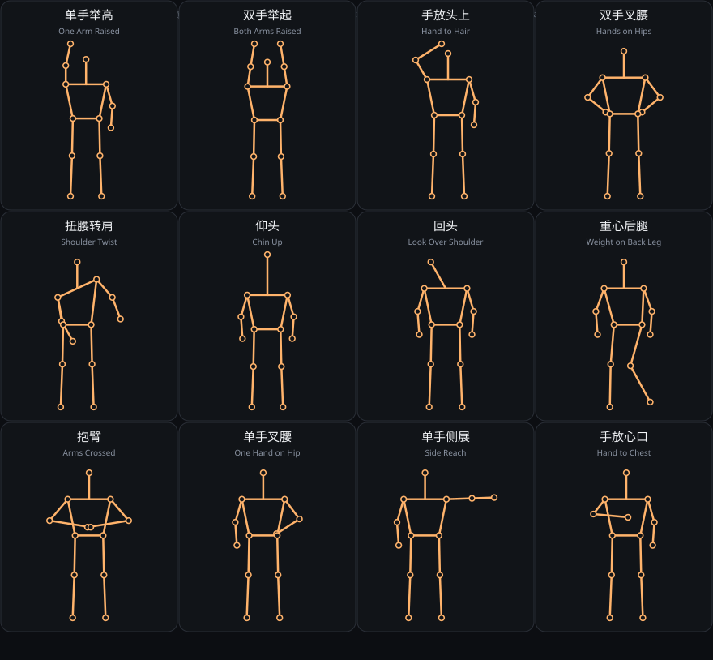

# 姿势素材库

12 个常见站姿人像引导姿势，机器可读模板见 [`poses.json`](poses.json)，整页示意
见 [`diagrams/pose-library.svg`](diagrams/pose-library.svg)（由
[`../../scripts/render_pose_library_svg.py`](../../scripts/render_pose_library_svg.py) 生成，
改动坐标后重新运行即可）。

## 字段约定

- 归一化图像坐标（x 向右、y 向下，0..1），肩线约 y=.28、髋线约 y=.50，躯干长 T≈.22；
  端上所有阈值以 T 为单位。
- 关节编号沿用 MediaPipe PoseLandmarker 33 点序；LEFT_* 是被摄者的左侧（后摄画面中
  出现在更大 x 一侧）。
- 每个姿势含中英语标题、分类（raise / waist / head / stance）、中文引导语、模板 15 个
  关节点、评分条件摘要。
- 端上的可执行版本（连续 0..1 评分、迟滞、缺失关节中文提示）在 street-snap 的
  `app/src/main/java/dev/streetsnap/app/pose/PoseCatalog.kt`。

## 目录

| 批次 | 姿势 |
| --- | --- |
| T72 首批 8 个 | 单手举高、双手举起、手放头上、双手叉腰、扭腰转肩、仰头、回头、重心后腿 |
| T115 第二批 4 个 | 抱臂、单手叉腰、单手侧展、手放心口 |

## 同步契约

每次端上姿势批次合并后：① 更新 `poses.json`（坐标与条件摘要）；② 重跑渲染脚本；
③ 在 `app_source.sync_status` 回填 street-snap merge SHA；④ 证据等级维持 experimental，
真人引导有效率在 T90（荣耀 Vs3 真机）/ T91（人工标注照片集）之前不得上调。

## 扩充候选（未实现）

坐姿、行走步幅、蹲姿、侧身站姿、双人/多人三角、手部细节（插兜、扶帽）。这些需要更完整
的关节可见性策略与真人标定，留给下一批次；几何上可由当前模板体系直接表达。
